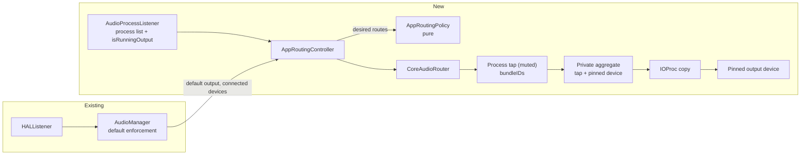

# Per-app output routing

## 📝 TLDR

Today AudioPin keeps one output device as the system default, so every app plays through it. The proposal is that users pin individual apps to their own output device, for example Spotify on headphones and Discord on the speakers, while all other apps keep following AudioPin's priority list. The routing would use Core Audio process taps (macOS 14.2+, tap by bundle ID since macOS 26). That requires the macOS **System Audio Recording** permission, so the feature is strictly opt-in and changes nothing for users who never create a rule.

## 📝 Resolved assumptions (autonomous defaults)

These defaults were applied by an unattended run. Correct any of them before merge.

| # | Question | Applied default | Why | Confirm? |
|---|----------|-----------------|-----|----------|
| Q1 | AudioPin promises "No permissions needed", and `AGENTS.md` forbids opening audio streams. Do we accept the System Audio Recording permission and a real-time audio stream for this feature? | Yes, but only as an opt-in. The permission is requested when the user creates their first rule. With no rules, no tap, stream or prompt ever exists. README, landing page and `AGENTS.md` are updated in the same release. | Per-app routing is impossible on macOS without capturing the app's audio. A third-party virtual driver would be heavier and needs admin install. | ⚠ NEEDS HUMAN CONFIRMATION: changes a public product promise and a repo rule |
| Q2 | Should one spec also cover per-app volume, EQ, or playing one app on several devices? | No. This spec covers only one output device per app. Per-app volume is a natural follow-up spec on the same tap pipeline. | Smallest working scope. Volume needs its own UI and a mixing design. | reversible |
| Q3 | What happens when an app's pinned device is disconnected? | The app falls back to the system default, which AudioPin already enforces. The rule is kept and resumes when the device returns. No per-app fallback list. | Reuses the existing priority list. A second priority model per app would double the settings surface. | reversible |
| Q4 | How is an app identified? | By bundle ID, persisted. Rules can exist for apps that are not running and apply when they start (`processRestoreEnabled`). | Process object IDs and PIDs change every launch. Bundle IDs are what users mean by "Spotify". | reversible |
| Q5 | Where does the UI live? | A new **Apps** pane in Settings only. A "Playing now" quick-routing section in the menu bar popover is a follow-up spec. | Matches the existing pane layout, keeps this spec to one capability, and keeps the popover small until the engine has proven itself. | reversible |
| Q6 | May we use private TCC SPI (`TCCAccessPreflight`) to check the permission state? | No, public API only. Phase 0 decides how permission denial is detected (see Risks). | Private SPI can break on any macOS update and goes against the project's dependency-free, low-risk stance. | reversible |
| Q7 | Do the pause switch and fast user switching also stop routing? | Yes. Pausing AudioPin or switching to another user tears down every tap, and apps play to the system default again. | Mirrors how enforcement already pauses. Users expect "pause" to mean everything. | reversible |

## 📝 Problem Statement

macOS has a single system output. Everything plays there unless an app has its own device picker. Discord, Zoom and Teams have one, but Spotify, Apple Music, browsers and games mostly do not. The common setup this blocks:

- Music or a game on headphones while a call plays on speakers, or the other way around.
- Calls on a USB headset while notifications and media stay on the speakers.
- Streamers sending one app to an interface and the rest to monitors.

Users solve this today with paid tools (Rogue Amoeba SoundSource) or open-source tap-based mixers (FineTune). AudioPin already owns the "which device should play" problem. Its users pin devices precisely because macOS guesses wrong, and per-app pinning is the next step of that promise.

Evidence level: this is inferred from the competitor landscape and the brief. There is no AudioPin user research. Treat demand as a hypothesis that Phase 0 and 1 make cheap to test.

## 📝 Proposed Solution

For each enabled rule whose app is running and whose pinned device is connected, the router keeps a **warm route**:

1. A private process tap for the app's bundle ID(s).
2. A private aggregate device containing the tap (input side) and the pinned device (output side, main sub-device), with drift compensation on the tap.
3. An IOProc on the aggregate that copies tap input buffers to the device's output buffers.

A warm route is always in one of two modes:

- **Passthrough**: the pinned device *is* the current default output. The tap is `CATapUnmuted` and the IOProc is stopped (`AudioDeviceStop`). The app plays to the default as usual, and nothing extra uses the CPU.
- **Routing**: the pinned device is *not* the default. The tap is `CATapMuted`, so the app's audio stops reaching the hardware and goes only into the tap, and the IOProc runs.

Switching modes is an in-place update: rewrite the tap's `muteBehavior` through `kAudioTapPropertyDescription` (settable on an existing tap per `AudioHardware.h`) and start or stop the IOProc. Nothing is torn down or rebuilt. The router reacts directly to `kAudioHardwarePropertyDefaultOutputDevice` changes from its own HAL listener, without waiting for `AudioManager`'s reconcile delays. So when macOS or the user moves the default away from the pinned device, the app stays on its device after only a few milliseconds of glitch, instead of playing on the wrong device until a tap is built. Taps and aggregates are destroyed only when the rule is disabled or removed, the app quits, the device disconnects, or AudioPin pauses.



The router is a new, separate component that reads `AudioManager`'s device state. Default-device enforcement stays untouched, and routing never changes a system default.

### Alternatives considered

| Option | Why it lost |
|---|---|
| Virtual HAL driver (Background Music / SoundSource ACE style) | Needs an installer with admin rights, a kernel-adjacent component in `/Library/Audio/Plug-Ins/HAL`, and a notarized build. AudioPin is ad-hoc signed and dependency-free. |
| Switching the system default per foreground app | Not per-app *routing*: two apps cannot play to two devices at once, and it fights AudioPin's own enforcement. |
| Tapping by process object ID (`processes`) instead of `bundleIDs` | Works on macOS 14.2+, but needs our own PID tracking and re-creating taps on every app relaunch. macOS 26 `bundleIDs` + `processRestoreEnabled` handle that natively, and AudioPin already requires macOS 27. |
| `CATapMutedWhenTapped` | Saves nothing here: we always read the tap while routing, and plain `CATapMuted` makes the intent explicit. |

### Market check

- **SoundSource 6** offers per-app output, volume, effects and grouped outputs. That is a lot of surface AudioPin should not copy. We take only per-app output.
- **FineTune** (open source, process taps) has per-app routing, multi-device output and an "ignore app" switch that tears down the tap. Worth copying: an obvious way to send an app back to normal macOS audio (our **System default** choice). Worth skipping: multi-device output and EQ.
- Both apps show what is currently playing. Our "Add App" sheet does the same with `kAudioProcessPropertyIsRunningOutput`.

## 📝 Architecture

New files (all in `Sources/AudioPin/`), following the existing split between pure policy, protocol-backed hardware access, and the `@MainActor` orchestrator:

| Component | Kind | Responsibility |
|---|---|---|
| `AppRoutingPolicy` | pure functions (like `PriorityPolicy`) | Given rules, running audio processes, connected output devices and the current default, return the warm routes that must exist, each with its mode (`passthrough` / `routing`) and its exact process bundle-ID list. Skips disabled rules, apps that are not running, and disconnected devices. Assigns **each process to at most one rule** (see Helper processes). |
| `RouteDeviceFilter` | pure function | `isOwnRouteDevice(uid:)`, which recognizes AudioPin's own aggregates by UID prefix. Unit-tested and applied in `AudioManager` device refresh, so the fake-backed tests exercise it. |
| `AudioRouter` protocol + `CoreAudioRouter` | hardware, like `AudioSystem` / `CoreAudioSystem` | `apply(_ desired: [WarmRoute])` diffs against live routes. It creates and destroys tap → aggregate → IOProc triples, switches modes in place, updates a tap's process list in place (`kAudioTapPropertyDescription`) when helpers appear or vanish, and reports per-route failures. It also listens for default-output changes so mode switches skip the reconcile delay. It also lists audio processes (`kAudioHardwarePropertyProcessObjectList`, `kAudioProcessPropertyBundleID`, `kAudioProcessPropertyPID`, `kAudioProcessPropertyIsRunningOutput`) and listens for changes to them. |
| `FakeAudioRouter` | test double in `Tests/AudioPinTests/Fakes.swift` | In-memory routes and processes, mirroring `FakeAudioSystem`. |
| `AppRoutingController` | `@MainActor @Observable` | Owns rule-related UI state (running audio apps, live route status, permission state). Re-runs the policy when settings change, the default output changes, devices change, the process list changes, on wake, or on pause/suspend. Logs to the existing activity log. |
| `RouteIOProc` | real-time code | The copy loop. Lives in its own file, is not `@MainActor`, and never allocates, locks, logs or touches Swift concurrency on the I/O thread. |

### Integration points in existing code

- **Device lists must exclude AudioPin's own aggregates.** Inside the creating process, private aggregates still appear in `kAudioHardwarePropertyDevices`. `AudioManager`'s device refresh drops every device for which `RouteDeviceFilter.isOwnRouteDevice` is true (UID prefix `dev.mjozefiak.AudioPin.route.`). Without this, the priority list would record and possibly pick our own aggregates. The filter sits above the `AudioSystem` protocol on purpose: `FakeAudioSystem.devices` returns its arrays directly, so a filter inside `AudioHAL` would never be exercised by tests.
- **`AudioManager`** exposes the inputs the controller needs: current default output and connected outputs (already public), plus a hook after each reconcile. The controller observes it. `AudioManager` does not import router types.
- **`AudioPinApp`** creates the controller next to `AudioManager` and forwards wake, suspend and pause.
- **`Resources/Info.plist`** gains `NSAudioCaptureUsageDescription`, localized EN + PL in the String Catalog.

### Helper processes

Browsers and Electron apps (Chrome, Discord, Slack) play audio from helper processes with their own bundle IDs (for example `com.google.Chrome.helper`). A rule for an app expands to its bundle ID plus every running audio process whose bundle ID starts with `<bundleID>.`. When the process list changes, the tap's `bundleIDs` list is updated in place, without destroying the tap, so playback never drops out.

Each process belongs to at most one rule, because two muted taps on one process have undefined behavior. An exact bundle-ID match beats a prefix match, and among prefix matches the longest prefix wins. Generic helper IDs shared across unrelated apps (for example `com.github.Electron.helper`) match no rule unless a rule names them exactly. The policy tests cover these cases. Phase 0 checks this against Discord, Chrome and Safari (WebKit uses `com.apple.WebKit.GPU`, which is shared by all WebKit apps, so Safari routing may be impossible per-app; see Edge Cases).

## 📝 Data Model

`AppSettings` (`Sources/AudioPin/Preferences.swift`) gains one field, decoded with `decodeIfPresent ?? []` per `BACKWARD_COMPATIBILITY.md`. The store key stays `AudioPin.settings.v1`.

```swift
struct AppRoute: Codable, Identifiable, Hashable, Sendable {
    var bundleID: String      // identity; validated `^[A-Za-z0-9.-]+$`
    var appName: String       // display cache, sanitized like device names
    var deviceUID: String     // target output device; matches KnownDevice.uid
    var deviceName: String    // display cache while the device is disconnected
    var isEnabled: Bool
    var id: String { bundleID }
}

// AppSettings
var appRoutes: [AppRoute] = []
```

- One rule per bundle ID. Choosing **System default** in the UI deletes the rule rather than storing a sentinel.
- Downgrade is safe: older builds ignore the unknown key, and their next save drops it. That data loss on downgrade is accepted and called out in release notes.
- No sensitive data: bundle IDs and device names are already visible system-wide. Nothing about the captured audio is stored or logged.
- New decode test: v1.2 JSON without `appRoutes` keeps priorities and yields `[]`. A round-trip test covers the new field.

## 📝 API Contracts

There are no network or public API changes. Internal contracts:

```swift
@MainActor protocol AudioRouter: AnyObject {
    func audioProcesses() -> [AudioProcess]               // bundleID, pid, isRunningOutput
    func apply(_ desired: [WarmRoute]) -> [RouteResult]   // idempotent diff, in-place mode/process updates
    func tearDownAll()
    func startListening(onChange: @escaping @Sendable (RouterEvent) -> Void) // processes, default output
    func stopListening()
}

enum RouteMode: Sendable { case passthrough, routing }
struct WarmRoute: Hashable, Sendable { let ruleID: String; let bundleIDs: [String]; let deviceUID: String; let mode: RouteMode }
enum RouteResult: Sendable { case active(ruleID: String, mode: RouteMode), probing(ruleID: String), failed(ruleID: String, reason: RouteFailure) }
enum RouteFailure: Sendable { case permissionDenied, deviceUnavailable, tapCreationFailed(OSStatus), aggregateFailed(OSStatus), ioFailed(OSStatus) }
```

`apply` is the only mutating entry point. Calling it with `[]` is equivalent to `tearDownAll()`, which is the rollback path for every state change.

## 📝 UI/UX

**Settings → Apps** (new pane between *Input* and *Activity*, symbol `app.badge`):

- Empty state: a one-paragraph explanation, a note that macOS will ask for **System Audio Recording** permission, and an **Add App…** button.
- **Add App…** opens a sheet listing apps currently producing audio (icon, name, "playing" indicator), with **Choose Other App…** (an `NSOpenPanel` on `/Applications`) for apps that are not running.
- Each rule row: app icon + name, a device `Picker` (connected outputs first, then remembered disconnected outputs from `outputPriority`, then **System default**), an enable toggle, and status text: *Routing* / *Plays on default (same device)* / *Waiting for permission* / *Device not connected, using default* / *App not running* / *Failed: …*. A context menu offers **Remove Rule**.
- Apps with their own output picker (Discord, Zoom, Teams, Slack, FaceTime; a small built-in list) show a hint in the row: "Set this app's own output to *System Default*, or it will be silent while routed".
- Permission banner (when denial is detected): explains that routing is off and has a button that opens *System Settings → Privacy & Security → Screen & System Audio Recording*.

Out of scope here: a "Playing now" quick-routing section in the menu bar popover. It is a follow-up spec once the engine has shipped.

**Activity log:** entries such as "Spotify → AirPods Max" and "Discord: device disconnected, back on MacBook Pro Speakers".

**Accessibility:** rows expose combined labels ("Spotify, routed to AirPods Max"). Status is conveyed in text, not only by color. Every new string is localized (EN + PL).

Mockups: skipped. AudioPin is a native SwiftUI app with no browser-renderable UI, and this repo has no `om-prepare-test-env` descriptor yet. UI checks for the implementation use the debug `--preview --pane=apps` mode with `AUDIOPIN_SNAPSHOT_DIR`, which Phase 3 extends with the new pane.

## 📝 Edge Cases & Failure Scenarios

| Scenario | Behavior |
|---|---|
| Permission not yet granted | The first route starts in a **probe**: the tap stays `CATapUnmuted`, and the IOProc reads the tap but writes silence to the pinned device. The app keeps playing on the default, so nothing plays twice. The macOS prompt appears when the aggregate starts. As soon as non-zero tap frames arrive, permission is confirmed and the route switches to *Routing*. Status: *Waiting for permission*. |
| Prompt ignored, or permission denied | If the probed process reports `isRunningOutput` for 10 s while the tap delivers only zeros, the controller treats permission as missing. It tears the route down (the app is never silenced), shows the banner, and probes again only on AudioPin activation, wake, or the user re-enabling the rule. No retry loop. The exact signal is confirmed in Phase 0. |
| Permission revoked later | Same detection while *Routing*: zeros for 10 s while the process is running output → tap unmuted and torn down → banner. |
| App has its own output device setting (Discord, Zoom) | `CATapMuted` blocks the process from **all** hardware, including a device chosen inside the app. The app is silent everywhere except the pinned device. The row hint tells the user to set the app's own output to *System Default*. |
| Pinned device disconnects | HAL device-list change → policy drops the route → tap destroyed → the app returns to the default output within one reconcile. Rule status: *Device not connected*. The route resumes on reconnect. |
| Pinned device becomes the system default | The route switches in place to *Passthrough* (tap unmuted, IOProc stopped). When the default moves away again, it switches back to *Routing* within milliseconds, with no rebuild. |
| Default output changes while routed | Routed apps keep playing on their pinned device. Only unrouted apps follow the new default. |
| macOS switches the default, then AudioPin reverts it | Pinned apps may flip mode twice within ~150 ms, with at most a short glitch on the pinned device. Accepted. Debouncing would bring back the wrong-device window. |
| Two rules match the same helper process | Impossible by construction: the policy assigns each process to one rule (exact match, then longest prefix). |
| App quits / relaunches | `processRestoreEnabled` keeps the tap bound by bundle ID. If Phase 0 shows that it is unreliable, the controller re-applies on process-list changes. |
| App plays from a shared system process (Safari/WebKit GPU process, `coreaudiod`-hosted audio) | It cannot be routed per-app without also moving every other app using that process. The Add App sheet marks such apps "not supported", and rule creation is blocked. |
| Sample-rate or channel mismatch (48 kHz tap → 44.1 kHz device, stereo → mono) | Drift compensation on the tap plus the aggregate's rate conversion. The IOProc maps stereo → mono by averaging and stereo → multichannel into channels 1–2. |
| Bluetooth headphones as target | The aggregate uses only their output stream. It must not pull the headset into HFP. Phase 0 verifies this with AirPods. |
| AudioPin crashes or is force-quit | Private taps and aggregates are owned by the process, and the HAL destroys them on exit, so apps unmute. Phase 0 verifies this explicitly. If it fails, startup runs a cleanup that destroys stale `dev.mjozefiak.AudioPin.route.*` aggregates. |
| Sleep / wake, fast user switching, pause switch | Tear down on suspend/pause. Rebuild after wake with the existing `wakeDelay`. |
| IOProc overload or HAL error | The route reports `ioFailed` once, is torn down (the app falls back to the default), and is logged. Retries are rate-limited with a `CorrectionLimiter` instance, so a broken device cannot cause a create/destroy loop. |
| Latency | One extra HAL buffer (target < 20 ms). Measured in Phase 0. Documented as unsuitable for latency-critical monitoring. |

## 📝 Risks & Impact Review

- **Product promise (direction call, Q1).** README ("No permissions needed… never opens a microphone"), the landing page and `AGENTS.md` ("Never open an audio stream") all change. Mitigation: opt-in, prompt only on first rule, and wording that says the audio is passed through and never stored. This needs the owner's decision before implementation.
- **Silence on permission denial (high).** A muted tap without permission may deliver zeros, so the app would go silent. There is no public API to preflight this permission. The design uses an unmuted probe with a 10 s zero-frame timeout (see Edge Cases). It never mutes before frames are confirmed, so the worst case is "routing doesn't start", not silence. Phase 0 confirms that a denied tap really delivers zeros rather than an error, and tunes the timeout. Implementation of Phase 2 is gated on that result.
- **Dependency on PR #11.** `AGENTS.md`, `BACKWARD_COMPATIBILITY.md` and `SDLC.md`, which this spec cites, arrive with the agent-pipeline setup PR (#11). Merge it first. Without it, the README is the reference.
- **Ad-hoc signing vs. TCC (medium).** TCC binds a grant to the code signature. With ad-hoc signing, every rebuilt release has a new identity, so users may have to grant the permission again after each update. Phase 0 checks whether this is true for consecutive DMGs. If it is, the release notes say so, and it strengthens the case for a Developer ID signature, which is outside this spec.
- **Real-time code under Swift 6 strict concurrency (medium).** The IOProc runs on a HAL thread. It must be a small, allocation-free closure over unsafe buffers with no actor hops. Code review checks it explicitly, and it is kept in one file.
- **macOS API maturity (medium).** `bundleIDs` and `processRestoreEnabled` are macOS 26 APIs with little public field data. The fallback is process-ID taps (macOS 14.2 API), already accounted for in `AudioRouter.apply`.
- **Settings compatibility (low).** One additive field, tolerant decode, no key change.
- **Rollback.** Before release, removing the Apps pane and controller fully reverts the change. After release, `appRoutes` stays in stored JSON and is ignored by builds without the feature. No persistent system state exists outside the process.

## 📋 Phasing

1. **Phase 0, Spike (gate):** prove the tap → aggregate → device path, in-place mode switching, and permission detection on the target OS. No user-facing change. Its results are appended to this spec and must be reviewed before Phase 2 starts. If the spike disproves the warm-route design, this spec is revised rather than worked around.
2. **Phase 1, Model + policy:** `AppRoute`, settings field, `AppRoutingPolicy`, `RouteDeviceFilter`, tests. Ships with no visible change.
3. **Phase 2, Router + controller:** real routing driven by rules, still with no UI (rules only via a debug path).
4. **Phase 3, Settings → Apps pane, permission flow, docs:** the feature becomes user-visible. README, landing page, `AGENTS.md` and release notes change in the same phase, so no release ships with a "No permissions needed" claim that is no longer true.

Phases 1–2 can merge without exposing anything. Phase 3 is the release point.

**Follow-ups (separate specs):** menu bar "Playing now" quick routing, per-app volume.

## 📋 Implementation Plan

### Phase 0: Spike (debug-only, `#if DEBUG`)

1. Add a debug-only `--route-test=<bundleID>:<deviceUID>` launch flag that builds one tap + aggregate + IOProc and logs status. Record latency, CPU, and behavior for Spotify, Discord, Chrome, Safari and Music, with AirPods and the built-in speakers. *Verify:* manual run notes appended to this spec under "Spike results".
2. Confirm in-place mode switching: rewriting `muteBehavior` and the `bundleIDs` list through `kAudioTapPropertyDescription` on a live tap, and the glitch length when the default moves away from the pinned device. *Verify:* documented outcome. If in-place updates fail, record the rebuild cost and revise this spec.
3. Confirm what a denied tap delivers (zeros vs. error), tune the probe timeout, and check whether consecutive ad-hoc builds keep the TCC grant. *Verify:* documented outcome, written into Phase 2 step 3.
4. Confirm crash cleanup (`kill -9` while routing → app audio returns) and HFP avoidance with AirPods. *Verify:* documented outcome.

### Phase 1: Model and policy

1. Add `AppRoute` and `AppSettings.appRoutes` with tolerant decoding. *Test:* old-JSON decode, round-trip, bundle-ID validation.
2. Add `AppRoutingPolicy.warmRoutes(rules:processes:connectedOutputs:defaultOutputUID:)`, including mode selection, helper-bundle expansion, one-rule-per-process assignment, and unsupported-process exclusion. *Test:* table-driven Swift Testing cases (disabled, passthrough vs. routing, disconnected, not running, helper expansion, exact-beats-prefix, shared generic helper, unsupported).
3. Add `RouteDeviceFilter.isOwnRouteDevice(uid:)` and apply it in `AudioManager`'s device refresh. *Test:* a pure test of the filter, plus an `AudioManagerTests` case where `FakeAudioSystem` reports a `dev.mjozefiak.AudioPin.route.*` device that never enters a priority list or becomes a default.

### Phase 2: Router and controller

1. Add the `AudioRouter` protocol and `FakeAudioRouter`. Add the process listing and listener to `CoreAudioRouter`. *Test:* fake-driven controller tests.
2. Implement warm-route create/destroy, in-place mode and process-list updates, and the default-output listener in `CoreAudioRouter`, with `RouteIOProc` channel mapping and probe-mode silence output. *Test:* unit-test the pure channel-mapping function. Hardware path verified manually per SDLC.
3. Add `AppRoutingController`: reconcile triggers, the probe → routing transition with the zero-frame timeout confirmed in Phase 0, pause/suspend/wake teardown, a `CorrectionLimiter`-based retry budget, and activity log entries. *Test:* controller tests with the fakes (default change → mode switch without rebuild, device loss → teardown, probe timeout → teardown + banner state, pause → `[]`, failure → back-off).

### Phase 3: Settings → Apps pane and docs

1. Add `NSAudioCaptureUsageDescription` (EN + PL) to `Info.plist` and the String Catalog. *Verify:* `plutil -lint`, `swift build`.
2. Add `SettingsWindow.Pane.apps`, the empty state, rule rows with status and the own-picker hint, and the Add App sheet. Extend `--preview --pane=apps`. *Verify:* preview snapshots in EN and PL.
3. Add the permission banner and the deep link to System Settings. *Verify:* manual QA with the permission denied and with the prompt ignored.
4. Update README Features/Permissions, `docs/index.html`, the `AGENTS.md` Core Audio rule, and release notes (re-grant after updates if Phase 0 confirms it). *Verify:* review. This must land before the release tag.
