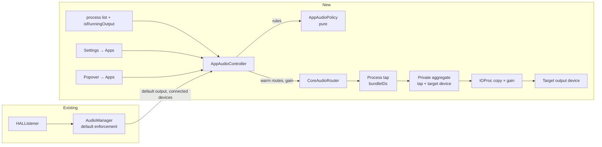

# Per-app audio: output routing and volume

## 📝 TLDR

Today AudioPin keeps one output device as the system default, so every app plays through it at the same volume. The proposal is that users pin individual apps to their own output device (Spotify on headphones, Discord on the speakers) and set a per-app volume and mute. They can do this in Settings and directly from the menu bar popover. Apps without a rule keep following AudioPin's priority list. Both features use Core Audio process taps (tap by bundle ID since macOS 26; AudioPin requires macOS 27). That requires the macOS **System Audio Recording** permission, so the feature is strictly opt-in and changes nothing for users who never touch it.

## 📝 Resolved assumptions

Q2 and Q5 were decided by the owner on 2026-11-01. The other rows are autonomous defaults; correct any of them before merge.

| # | Question | Answer | Why | Confirm? |
|---|----------|--------|-----|----------|
| Q1 | AudioPin promises "No permissions needed", and `AGENTS.md` forbids opening audio streams. Do we accept the System Audio Recording permission and a real-time audio stream for this feature? | Yes, but only as an opt-in. The permission is requested on the first per-app change (device, volume or mute). With no rules, no tap, stream or prompt ever exists. README, landing page and `AGENTS.md` are updated in the same release. | Per-app routing and per-app volume are both impossible on macOS without capturing the app's audio. A third-party virtual driver would be heavier and needs an admin install. | ⚠ NEEDS HUMAN CONFIRMATION: changes a public product promise and a repo rule |
| Q2 | Scope: also per-app volume, EQ, multi-device output? | **Owner decision:** per-app output device **and** per-app volume + mute are in this spec. EQ, volume boost above 100% and playing one app on several devices are out. | Volume uses the same tap + IOProc pipeline as routing, so it adds a gain stage, not a second engine. | decided |
| Q3 | What happens when an app's pinned device is disconnected? | The app falls back to the system default, which AudioPin already enforces. Its volume and mute still apply. The device choice is kept and resumes when the device returns. No per-app fallback list. | Reuses the existing priority list. A second priority model per app would double the settings surface. | reversible |
| Q4 | How is an app identified? | By bundle ID, persisted. Rules can exist for apps that are not running and apply when they start (`processRestoreEnabled`). | Process object IDs and PIDs change every launch. Bundle IDs are what users mean by "Spotify". | reversible |
| Q5 | Where does the UI live? | **Owner decision:** both a new **Settings → Apps** pane (full management) and an **Apps** section in the menu bar popover (quick device, volume and mute per playing app). | Quick changes happen in the popover, where users already switch devices. | decided |
| Q6 | May we use private TCC SPI (`TCCAccessPreflight`) to check the permission state? | No, public API only. An unmuted probe with a zero-frame timeout detects denial (see Edge Cases). | Private SPI can break on any macOS update and goes against the project's dependency-free, low-risk stance. | reversible |
| Q7 | Do the pause switch and fast user switching also stop routing and volume? | Yes. Pausing AudioPin or switching to another user tears down every tap, and apps play to the system default at full volume. | Mirrors how enforcement already pauses. Users expect "pause" to mean everything. | reversible |
| Q8 | Volume range and curve? | 0–100% (no boost), mute as a separate toggle that remembers the level. The slider uses a perceptual curve (`gain = position²`). Per-app volume multiplies the device volume, it does not replace it. | Boost needs a limiter to avoid clipping. A linear-amplitude slider feels like it "does nothing" for the top half. | reversible |
| Q9 | Does the popover Apps section show for everyone? | Yes by default, with a **Show apps in menu** toggle in General. Listing playing apps needs no permission, so the prompt still only appears on the first change. | Discoverability is the point of the popover. The toggle covers users who want the old compact menu. | reversible |

## 📝 Problem Statement

macOS has a single system output and one volume for everything. Discord, Zoom and Teams have their own device pickers and volume settings, but Spotify, Apple Music, browsers and games mostly do not. The common setups this blocks:

- Music or a game on headphones while a call plays on the speakers, or the other way around.
- A call that is too quiet next to music, or a browser tab that is too loud, with no way to balance them except inside each app (if the app allows it at all).
- Streamers sending one app to an interface and the rest to monitors.

Users solve this today with paid tools (Rogue Amoeba SoundSource) or open-source tap-based mixers (FineTune). AudioPin already owns the "which device should play" problem. Its users pin devices precisely because macOS guesses wrong, and per-app device and volume are the next step of that promise.

Evidence level: this is inferred from the competitor landscape and the owner's request. There is no AudioPin user research.

## 📝 Proposed Solution

### Rules

A **rule** belongs to one app (bundle ID) and holds: a target device (a specific output, or *System default*), a volume (0–100%), and mute. A rule that is back to *System default* at 100% and not muted is neutral and is deleted. So "no rule" always means plain macOS behavior.

### Warm routes

For each enabled rule whose app is running, the router keeps a **warm route**:

1. A private process tap for the app's bundle ID(s).
2. A private aggregate device containing the tap (input side) and the resolved target (output side, main sub-device), with drift compensation on the tap. The resolved target is the pinned device if it is connected, otherwise the current system default.
3. An IOProc on the aggregate that copies tap input to the device output, multiplied by the rule's gain.

A warm route is always in one of two modes:

- **Passthrough**: the resolved target *is* the current default, the volume is 100%, and the app is not muted. The tap is `CATapUnmuted` and the IOProc is stopped (`AudioDeviceStop`). The app plays to the default as usual, and nothing extra uses the CPU.
- **Routing**: anything else (a different device, volume below 100%, or muted). The tap is `CATapMuted`, so the app's audio stops reaching the hardware and goes only into the tap, and the IOProc runs with the rule's gain.

Switching modes is an in-place update: rewrite the tap's `muteBehavior` through `kAudioTapPropertyDescription` (settable on an existing tap per `AudioHardware.h`) and start or stop the IOProc. Nothing is torn down. The router reacts directly to `kAudioHardwarePropertyDefaultOutputDevice` changes from its own HAL listener, without waiting for `AudioManager`'s reconcile delays. So when the default moves away from a pinned device, the app stays on its device after only a few milliseconds of glitch.

**Rules that follow the system default.** These are volume-only rules, or rules whose pinned device is disconnected. When the default changes, the aggregate's output sub-device must change too. The router first tries an in-place sub-device swap (`kAudioAggregateDevicePropertyComposition`). If that fails, it rebuilds the aggregate while keeping the tap muted. A short silence is preferred to a burst at full volume. Phase 0 measures both paths.

### Volume

- The gain is a single `Float` the IOProc reads atomically (Swift `Synchronization.Atomic` over the bit pattern), with no locks on the real-time thread.
- Each buffer ramps linearly from the previous gain to the new one, so slider drags and mute toggles never click.
- Mute sets the gain to 0 but keeps the route in *Routing*, so unmuting is instant and returns to the remembered level.
- While a slider is dragged, the UI calls the router's fast gain path directly (`setGain`). The rule is written to settings only when the drag ends. This avoids a JSON save and an `AudioManager` reconcile on every slider tick (`AppSettings.didSet` does both today).



The controller is a new, separate component that reads `AudioManager`'s device state. Default-device enforcement stays untouched, and per-app audio never changes a system default.

### Alternatives considered

| Option | Why it lost |
|---|---|
| Virtual HAL driver (Background Music / SoundSource ACE style) | Needs an installer with admin rights, a kernel-adjacent component in `/Library/Audio/Plug-Ins/HAL`, and a notarized build. AudioPin is ad-hoc signed and dependency-free. |
| Switching the system default per foreground app | Not per-app routing: two apps cannot play to two devices at once, it offers no per-app volume, and it fights AudioPin's own enforcement. |
| Tapping by process object ID (`processes`) instead of `bundleIDs` | Works on macOS 14.2+, but needs our own PID tracking and re-creating taps on every app relaunch. macOS 26 `bundleIDs` + `processRestoreEnabled` handle that natively. Kept as the fallback. |
| Changing each app's volume through AppleScript or app APIs | Only a handful of apps support it, and it does nothing for routing. |
| `CATapMutedWhenTapped` | Saves nothing here: we always read the tap while routing, and plain `CATapMuted` makes the intent explicit. |

### Market check

- **SoundSource 6** has per-app output, volume, effects and grouped outputs, all in its menu bar window. We take per-app output and volume, and the "everything from the menu bar" placement. We skip effects and grouped outputs.
- **FineTune** (open source, process taps) has per-app volume, routing, multi-device output and an "ignore app" switch that tears down the tap. Worth copying: an obvious way to return an app to plain macOS audio (rules return to neutral and disappear). Worth skipping: multi-device output and EQ.
- Both show what is currently playing. Our popover section and Add App sheet do the same with `kAudioProcessPropertyIsRunningOutput`.

## 📝 Architecture

New files (all in `Sources/AudioPin/`), following the existing split between pure policy, protocol-backed hardware access, and the `@MainActor` orchestrator:

| Component | Kind | Responsibility |
|---|---|---|
| `AppAudioPolicy` | pure functions (like `PriorityPolicy`) | Given rules, running audio processes, connected output devices and the current default, return the warm routes that must exist. Each has a mode (`passthrough` / `routing`), resolved target device UID, gain and exact process bundle-ID list. Skips disabled rules and apps that are not running. Assigns **each process to at most one rule** (see Helper processes). Also owns the slider-to-gain curve and the "rule is neutral" check. |
| `RouteDeviceFilter` | pure function | `isOwnRouteDevice(uid:)`, which recognizes AudioPin's own aggregates by UID prefix. Applied in `AudioManager` device refresh, so fake-backed tests exercise it. |
| `AudioRouter` protocol + `CoreAudioRouter` | hardware, like `AudioSystem` / `CoreAudioSystem` | `apply(_:)` diffs warm routes against live ones. It creates and destroys tap → aggregate → IOProc triples, switches modes in place, swaps the target sub-device, and updates a tap's process list in place when helpers appear or vanish. `setGain(_:ruleID:)` is the fast path for sliders. It lists audio processes (`kAudioHardwarePropertyProcessObjectList`, `kAudioProcessPropertyBundleID`, `kAudioProcessPropertyPID`, `kAudioProcessPropertyIsRunningOutput`) and listens for process and default-output changes. |
| `FakeAudioRouter` | test double in `Tests/AudioPinTests/Fakes.swift` | In-memory routes, gains and processes, mirroring `FakeAudioSystem`. |
| `AppAudioController` | `@MainActor @Observable` | Owns per-app UI state: playing apps (name, icon, playing flag), live route status, permission state, and the per-app values shown while sliders move. Re-runs the policy when settings change, the default output changes, devices change, the process list changes, on wake, or on pause/suspend. Exposes the intents both UIs use: `setDevice`, `setVolume(live:)`, `commitVolume`, `setMuted`, `removeRule`. Logs device changes and failures to the existing activity log. Volume changes are not logged, to avoid noise. |
| `RouteIOProc` | real-time code | Copy × gain with a per-buffer ramp and channel mapping. Lives in its own file, is not `@MainActor`, and never allocates, locks, logs or touches Swift concurrency on the I/O thread. |
| `AppAudioRow` | SwiftUI view | One shared row (icon, name, device menu, volume slider, mute) in `regular` (Settings) and `compact` (popover) sizes, so both surfaces behave identically. |

### Integration points in existing code

- **Device lists must exclude AudioPin's own aggregates.** Inside the creating process, private aggregates still appear in `kAudioHardwarePropertyDevices`. `AudioManager`'s device refresh drops every device for which `RouteDeviceFilter.isOwnRouteDevice` is true (UID prefix `dev.mjozefiak.AudioPin.route.`). Without this, the priority list would record and possibly pick our own aggregates. The filter sits above the `AudioSystem` protocol on purpose: `FakeAudioSystem.devices` returns its arrays directly, so a filter inside `AudioHAL` would never be exercised by tests.
- **`AudioManager`** exposes the inputs the controller needs: current default output and connected outputs (already public), plus a hook after each reconcile. The controller observes it. `AudioManager` does not import router types.
- **`MenuBarView`** gains an `AppsSection` between the *Speakers & Headphones* and *Microphones* sections, styled like `DirectionSection` (same header, the rounded `.quaternary` background).
- **`AudioPinApp`** creates the controller next to `AudioManager`, injects it into the environment for both scenes, and forwards wake, suspend and pause.
- **`Resources/Info.plist`** gains `NSAudioCaptureUsageDescription`, localized EN + PL in the String Catalog.

### Helper processes

Browsers and Electron apps (Chrome, Discord, Slack) play audio from helper processes with their own bundle IDs (for example `com.google.Chrome.helper`). A rule for an app expands to its bundle ID plus every running audio process whose bundle ID starts with `<bundleID>.`. When the process list changes, the tap's `bundleIDs` list is updated in place, without destroying the tap, so playback never drops out. The popover and the Add App sheet group helpers under their parent app, so users never see "Google Chrome Helper (Renderer)".

Each process belongs to at most one rule, because two muted taps on one process have undefined behavior. An exact bundle-ID match beats a prefix match, and among prefix matches the longest prefix wins. Generic helper IDs shared across unrelated apps (for example `com.github.Electron.helper`) match no rule unless a rule names them exactly. Phase 0 checks this against Discord, Chrome and Safari (WebKit plays from `com.apple.WebKit.GPU`, which is shared by all WebKit apps; see Edge Cases).

## 📝 Data Model

`AppSettings` (`Sources/AudioPin/Preferences.swift`) gains two fields, both decoded with `decodeIfPresent ?? default` per `BACKWARD_COMPATIBILITY.md`. The store key stays `AudioPin.settings.v1`.

```swift
struct AppRule: Codable, Identifiable, Hashable, Sendable {
    var bundleID: String       // identity; validated `^[A-Za-z0-9.-]+$`
    var appName: String        // display cache, sanitized like device names
    var deviceUID: String?     // nil = follow the system default
    var deviceName: String?    // display cache while the device is disconnected
    var volume: Float = 1      // slider position 0...1; gain = volume²
    var isMuted = false
    var isEnabled = true
    var id: String { bundleID }

    /// Plain macOS behavior: the rule is deleted instead of stored.
    var isNeutral: Bool { deviceUID == nil && volume >= 1 && !isMuted }
}

// AppSettings
var appRules: [AppRule] = []
var showAppsInMenu = true
```

- One rule per bundle ID. Neutral rules are never persisted.
- `AppRule` decodes each field with `decodeIfPresent`, so a future field never drops existing rules.
- Downgrade: older builds ignore the unknown keys, and their next save drops them. That data loss on downgrade is accepted and called out in release notes.
- No sensitive data: bundle IDs and device names are already visible system-wide. Nothing about the captured audio is stored or logged.
- Tests: v1.2 JSON without the new keys keeps priorities and yields `[]` / `true`; a rule round-trip; a rule with missing optional fields decodes with defaults.

## 📝 API Contracts

There are no network or public API changes. Internal contracts:

```swift
@MainActor protocol AudioRouter: AnyObject {
    func audioProcesses() -> [AudioProcess]               // bundleID, pid, isRunningOutput
    func apply(_ desired: [WarmRoute]) -> [RouteResult]   // idempotent diff; in-place mode, process-list and target updates
    func setGain(_ gain: Float, ruleID: String)           // fast path, no diff; ramps in the IOProc
    func tearDownAll()
    func startListening(onChange: @escaping @Sendable (RouterEvent) -> Void) // processes, default output
    func stopListening()
}

enum RouteMode: Sendable { case passthrough, routing }
struct WarmRoute: Hashable, Sendable {
    let ruleID: String; let bundleIDs: [String]; let deviceUID: String; let mode: RouteMode; let gain: Float
}
enum RouteResult: Sendable { case active(ruleID: String, mode: RouteMode), probing(ruleID: String), failed(ruleID: String, reason: RouteFailure) }
enum RouteFailure: Sendable { case permissionDenied, deviceUnavailable, tapCreationFailed(OSStatus), aggregateFailed(OSStatus), ioFailed(OSStatus) }
```

`apply` is the only structural mutation. Calling it with `[]` is equivalent to `tearDownAll()`, which is the rollback path for every state change.

## 📝 UI/UX

### Menu bar popover → Apps

A new section between *Speakers & Headphones* and *Microphones*, hidden when **Show apps in menu** is off.

- Header "Apps" with the same style as the other sections. When nothing is playing and no running app has a rule, it shows one line: "No apps playing".
- Rows list running apps that are producing audio or have a rule. Playing apps come first, then alphabetical order, with at most 5 rows and a "More in Settings…" link. Rows appear and disappear live as apps start and stop playing; a row lingers for 5 s after playback stops so it does not jump away under the cursor.
- Compact `AppAudioRow`: app icon (click toggles mute, shown with a slash when muted), name, a small device button (speaker glyph + short device name, or "Default"), and a slider below the name. The device button opens a menu: *System default*, then connected outputs in priority order, with a checkmark on the current choice.
- Any change creates or updates the rule. Moving everything back to *System default*, 100% and unmuted removes it.
- Before permission is granted: the first change starts the probe, and the row shows a spinner with "Waiting for permission…". If permission is missing, the row's controls are disabled and the section shows one inline line, "Allow AudioPin in System Settings", which opens *Privacy & Security → Screen & System Audio Recording*.
- Apps that cannot be controlled (shared WebKit process, see Edge Cases) show disabled controls with a "Not supported" tooltip.

### Settings → Apps

A new pane between *Input* and *Activity* (symbol `app.badge`):

- Empty state: a one-paragraph explanation, a note that macOS will ask for **System Audio Recording** permission, and an **Add App…** button.
- **Add App…** opens a sheet listing apps currently producing audio (icon, name, "playing" indicator), with **Choose Other App…** (an `NSOpenPanel` on `/Applications`) for apps that are not running. A newly added rule starts neutral-but-kept until the user changes something, and it is dropped if the sheet is closed without a change.
- Each rule row (regular `AppAudioRow`): app icon + name, a device `Picker` (connected outputs first, then remembered disconnected outputs from `outputPriority`, then **System default**), volume slider with percentage, mute toggle, enable toggle, and status text: *Routing* / *Volume only* / *Plays on default (same device)* / *Waiting for permission* / *Device not connected, using default* / *App not running* / *Failed: …*. A context menu offers **Reset to Default** (removes the rule).
- Apps with their own output picker (Discord, Zoom, Teams, Slack, FaceTime; a small built-in list) show a hint: "Set this app's own output to *System Default*, or it will be silent while routed".
- Permission banner (when denial is detected), with a button to *System Settings → Privacy & Security → Screen & System Audio Recording*.
- **General** pane gains the **Show apps in menu** toggle.

### Shared

- **Activity log:** "Spotify → AirPods Max", "Discord: device disconnected, back on MacBook Pro Speakers", "Per-app audio paused: permission missing". No entries for volume changes.
- **Accessibility:** rows expose combined labels ("Spotify, AirPods Max, volume 60%, muted"). Sliders have an accessibility value in percent and support increment/decrement. Mute and status are conveyed in text and symbol, not only by color. Every new string is localized (EN + PL).
- Mockups: skipped. AudioPin is a native SwiftUI app with no browser-renderable UI, and this repo has no `om-prepare-test-env` descriptor yet. UI checks use the debug `--preview --pane=apps` mode with `AUDIOPIN_SNAPSHOT_DIR`, which also snapshots the popover. Phases 3 and 4 extend it with fake playing apps.

## 📝 Edge Cases & Failure Scenarios

| Scenario | Behavior |
|---|---|
| Permission not yet granted | The first route starts in a **probe**: the tap stays `CATapUnmuted`, and the IOProc reads the tap but writes silence. The app keeps playing on the default at its normal level, so nothing plays twice. The macOS prompt appears when the aggregate starts. As soon as non-zero tap frames arrive, permission is confirmed and the route takes its real mode. Status: *Waiting for permission*. |
| Prompt ignored, or permission denied | If the probed process reports `isRunningOutput` for 10 s while the tap delivers only zeros, the controller treats permission as missing. It tears the route down (the app is never silenced), shows the banner or popover line, and probes again only on AudioPin activation, wake, or a new user change. No retry loop. The exact signal is confirmed in Phase 0. |
| Permission revoked later | Same detection while *Routing*: zeros for 10 s while the process is running output → tap unmuted and torn down → banner. |
| Muted app vs. "permission missing" | A muted rule still reads the tap, so non-zero input frames keep proving permission even though the output is silent. |
| App has its own output device setting (Discord, Zoom) | `CATapMuted` blocks the process from **all** hardware, including a device chosen inside the app. The app is silent everywhere except the target. The hint tells the user to set the app's own output to *System Default*. This also applies to volume-only rules. |
| Pinned device disconnects | Policy resolves the target to the current default. The route stays in *Routing* if volume or mute is set, otherwise it switches to *Passthrough*. Status: *Device not connected, using default*. The pinned device returns automatically on reconnect. |
| Resolved target becomes the system default | Volume 100% and not muted: switch in place to *Passthrough*. Otherwise stay in *Routing*. |
| Default changes under a follow-default rule in *Routing* | In-place sub-device swap, or an aggregate rebuild with the tap kept muted (short silence, never a full-volume burst). |
| macOS switches the default, then AudioPin reverts it | Pinned apps may flip mode twice within ~150 ms, with at most a short glitch. Accepted. Debouncing would bring back the wrong-device window. |
| Slider dragged quickly | Gain updates go through `setGain` only, and the IOProc ramps per buffer. Settings are written once, on release. |
| Volume at 0% vs. mute | 0% is a level, mute is a toggle that remembers the level. Both keep the route warm. |
| Two rules match the same helper process | Impossible by construction: the policy assigns each process to one rule (exact match, then longest prefix). |
| App quits / relaunches | `processRestoreEnabled` keeps the tap bound by bundle ID. If Phase 0 shows that it is unreliable, the controller re-applies on process-list changes. The popover row disappears 5 s after the app quits. |
| App plays from a shared system process (Safari/WebKit GPU process) | It cannot be controlled per-app without also affecting every other app using that process. The popover and Add App sheet mark it "Not supported", and changes are blocked. |
| Many playing apps | The popover caps at 5 rows. Each warm route in *Routing* costs one IOProc, and Phase 0 measures CPU with 5 concurrent routes. |
| Sample-rate or channel mismatch (48 kHz tap → 44.1 kHz device, stereo → mono) | Drift compensation on the tap plus the aggregate's rate conversion. The IOProc maps stereo → mono by averaging and stereo → multichannel into channels 1–2. |
| Bluetooth headphones as target | The aggregate uses only their output stream. It must not pull the headset into HFP. Phase 0 verifies this with AirPods. |
| AudioPin crashes or is force-quit | Private taps and aggregates are owned by the process, and the HAL destroys them on exit, so apps unmute at full volume. Phase 0 verifies this explicitly. If it fails, startup destroys stale `dev.mjozefiak.AudioPin.route.*` aggregates. |
| Sleep / wake, fast user switching, pause switch | Tear down on suspend/pause. Rebuild after wake with the existing `wakeDelay`. The popover section shows "Paused" while AudioPin is paused. |
| IOProc overload or HAL error | The route reports `ioFailed` once, is torn down (the app falls back to the default at full volume), and is logged. Retries are rate-limited with a `CorrectionLimiter` instance, so a broken device cannot cause a create/destroy loop. |
| Latency | One extra HAL buffer (target < 20 ms), also for volume-only rules. Measured in Phase 0. Documented as unsuitable for latency-critical monitoring. |

## 📝 Risks & Impact Review

- **Product promise (direction call, Q1).** README ("No permissions needed… never opens a microphone"), the landing page and `AGENTS.md` ("Never open an audio stream") all change. Mitigation: opt-in, prompt only on the first change, and wording that says the audio is passed through and never stored. This needs the owner's decision before implementation.
- **Silence on permission denial (high).** A muted tap without permission may deliver zeros, so the app would go silent. There is no public API to preflight this permission. The unmuted probe with a 10 s zero-frame timeout never mutes before frames are confirmed, so the worst case is "the change doesn't take effect", not silence. Phase 0 confirms that a denied tap really delivers zeros rather than an error. Phase 2 is gated on that result.
- **Volume-only rules add latency and a tap to apps that stay on the default (medium).** That is the cost of software gain. Users get it only for apps they explicitly turn down. The *Volume only* status makes it visible.
- **Popover growth (low).** The popover gets taller for every user. Mitigations: the 5-row cap, a one-line empty state, and the **Show apps in menu** toggle.
- **Ad-hoc signing vs. TCC (medium).** TCC binds a grant to the code signature. With ad-hoc signing, every rebuilt release has a new identity, so users may have to grant the permission again after each update. Phase 0 checks this with consecutive DMGs. If confirmed, the release notes say so, and it strengthens the case for a Developer ID signature (outside this spec).
- **Real-time code under Swift 6 strict concurrency (medium).** The IOProc runs on a HAL thread. It must be a small, allocation-free closure over unsafe buffers and an atomic gain, with no actor hops. Code review checks it explicitly, and it is kept in one file.
- **macOS API maturity (medium).** `bundleIDs` and `processRestoreEnabled` are macOS 26 APIs with little public field data. The fallback is process-ID taps (macOS 14.2 API), already accounted for in `AudioRouter.apply`.
- **Scope (accepted by the owner).** This spec bundles routing, volume and two UI surfaces. They share one engine and one controller, and the phases below keep each step shippable.
- **Dependency on PR #11.** `AGENTS.md`, `BACKWARD_COMPATIBILITY.md` and `SDLC.md`, which this spec cites, arrive with the agent-pipeline setup PR (#11). Merge it first.
- **Settings compatibility (low).** Two additive fields, tolerant decode, no key change.
- **Rollback.** Before release, removing the controller and both UI surfaces fully reverts the change. After release, the new keys stay in stored JSON and are ignored by builds without the feature. No persistent system state exists outside the process.

## 📋 Phasing

1. **Phase 0, Spike (gate):** prove the tap → aggregate → device path with gain, in-place mode, sub-device and process-list updates, and permission detection on the target OS. No user-facing change. Results are appended to this spec and reviewed before Phase 2. If the spike disproves the warm-route design, this spec is revised rather than worked around.
2. **Phase 1, Model + policy:** `AppRule`, settings fields, `AppAudioPolicy`, `RouteDeviceFilter`, tests. No visible change.
3. **Phase 2, Router + controller:** real routing and volume driven by rules, still with no UI (rules only via a debug path).
4. **Phase 3, Settings → Apps pane, permission flow, docs:** the feature becomes visible in Settings. README, landing page, `AGENTS.md` and release notes change in this phase, so no build on `main` claims "No permissions needed" next to a feature that needs it.
5. **Phase 4, Popover Apps section:** quick device, volume and mute from the menu bar, plus the **Show apps in menu** toggle.

Phases 1–2 merge without exposing anything. The release ships after Phase 4, so the feature launches with both surfaces.

**Follow-ups (separate specs):** volume boost above 100% with a limiter, EQ, multi-device output, per-app input (microphone) routing.

## 📋 Implementation Plan

### Phase 0: Spike (debug-only, `#if DEBUG`)

1. Add a debug-only `--route-test=<bundleID>:<deviceUID|default>:<volume>` launch flag that builds one warm route and logs status. Record latency, CPU (1 and 5 concurrent routes) and behavior for Spotify, Discord, Chrome, Safari and Music, with AirPods and the built-in speakers. *Verify:* manual run notes appended to this spec under "Spike results".
2. Confirm in-place updates on a live route: `muteBehavior` and `bundleIDs` through `kAudioTapPropertyDescription`, and the aggregate sub-device swap. Measure glitch or silence length for each, and confirm the gain ramp is click-free. *Verify:* documented outcome. If in-place updates fail, record the rebuild cost and revise this spec.
3. Confirm what a denied tap delivers (zeros vs. error), that listing processes needs no permission, tune the probe timeout, and check whether consecutive ad-hoc builds keep the TCC grant. *Verify:* documented outcome, written into Phase 2 step 3.
4. Confirm crash cleanup (`kill -9` while routing → app audio returns at full volume) and HFP avoidance with AirPods. *Verify:* documented outcome.

### Phase 1: Model and policy

1. Add `AppRule`, `AppSettings.appRules` and `AppSettings.showAppsInMenu` with tolerant decoding. *Test:* old-JSON decode, round-trip, partial-rule decode, bundle-ID validation, `isNeutral`.
2. Add `AppAudioPolicy.warmRoutes(rules:processes:connectedOutputs:defaultOutputUID:)` and `gain(forVolume:muted:)`. *Test:* table-driven Swift Testing cases: disabled, not running, passthrough vs. routing (device / volume / mute), disconnected pin → default target, follow-default target, helper expansion, exact-beats-prefix, shared generic helper, unsupported process, gain curve endpoints.
3. Add `RouteDeviceFilter.isOwnRouteDevice(uid:)` and apply it in `AudioManager`'s device refresh. *Test:* a pure test of the filter, plus an `AudioManagerTests` case where `FakeAudioSystem` reports a `dev.mjozefiak.AudioPin.route.*` device that never enters a priority list or becomes a default.

### Phase 2: Router and controller

1. Add the `AudioRouter` protocol and `FakeAudioRouter`. Add process listing and the process/default-output listener to `CoreAudioRouter`. *Test:* fake-driven controller tests.
2. Implement warm-route create/destroy, in-place mode, process-list and target updates, and `setGain` in `CoreAudioRouter`. `RouteIOProc` handles gain ramping, channel mapping and probe-mode silence. *Test:* unit-test the pure ramp and channel-mapping functions on in-memory buffers. Hardware path verified manually per SDLC.
3. Add `AppAudioController`: the intents (`setDevice`, `setVolume(live:)`, `commitVolume`, `setMuted`, `removeRule`), neutral-rule removal, reconcile triggers, the probe → active transition with the timeout confirmed in Phase 0, pause/suspend/wake teardown, a `CorrectionLimiter`-based retry budget, and activity log entries. *Test:* controller tests with the fakes: default change → mode switch without rebuild, device loss → default target, live volume → `setGain` only with no settings save, commit → one save, back to neutral → rule removed, probe timeout → teardown + permission state, pause → `[]`, failure → back-off.

### Phase 3: Settings → Apps pane and docs

1. Add `NSAudioCaptureUsageDescription` (EN + PL) to `Info.plist` and the String Catalog. *Verify:* `plutil -lint`, `swift build`.
2. Add the shared `AppAudioRow` (regular size), `SettingsWindow.Pane.apps`, the empty state, rule rows with status and the own-picker hint, and the Add App sheet. Extend `--preview --pane=apps` with fake playing apps. *Verify:* preview snapshots in EN and PL.
3. Add the permission banner and the deep link to System Settings. *Verify:* manual QA with the permission denied and with the prompt ignored.
4. Update README Features/Permissions, `docs/index.html`, the `AGENTS.md` Core Audio rule, and the draft release notes (re-grant after updates if Phase 0 confirms it). *Verify:* review.

### Phase 4: Popover Apps section

1. Add the compact `AppAudioRow` and `AppsSection` in `MenuBarView` (live list, 5-row cap, 5 s linger, device menu, slider, mute on icon, permission line, "Paused" state). Extend `--preview` to snapshot the popover with fake playing apps. *Verify:* preview snapshots in EN and PL, plus manual QA of live changes while Spotify plays.
2. Add the **Show apps in menu** toggle to the General pane. *Test:* `AppSettings` default plus a view-model test that the section is hidden when the toggle is off. *Verify:* preview snapshot.
